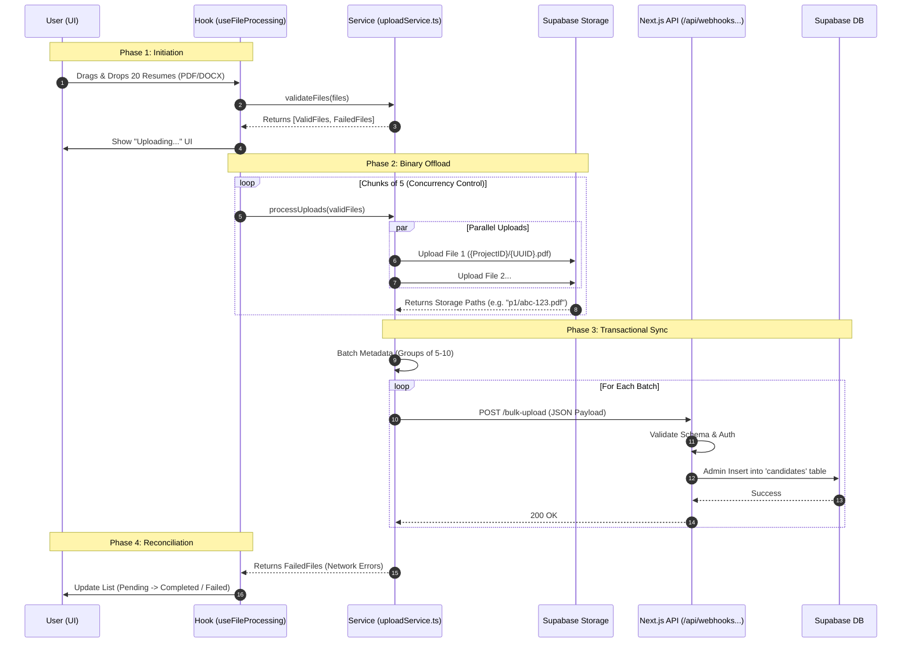

# 🚀 Scalable Bulk Scanning & Upload Architecture

## 1. Executive Summary

The STROKE scanning engine utilizes a **Hybrid Client-Side Storage / Server-Side Metadata** pattern. 

### The Problem
Traditional file uploads in serverless environments (like Vercel/Next.js) face strict limitations:
1.  **Body Size Limits:** Requests > 4.5MB are often rejected.
2.  **Execution Timeouts:** Processing 50+ PDFs sequentially causes server timeouts (10s-60s limits).
3.  **Memory Bloat:** Parsing multiple binary files in Node.js spikes memory usage.

### The Solution
We decouple the **Binary Transfer** from the **Data Persistence**:
1.  **Binaries** go directly from the Browser to Supabase Storage (bypassing our API).
2.  **Metadata** goes to our Next.js API as a lightweight JSON payload.
3.  **Database Sync** happens via a secure Server-Side webhook using Admin privileges.

---

## 2. Architecture Diagram



---

## 3. Step-by-Step Implementation Detail

### Step 1: User Initiation & Validation
**Location:** `hooks/useFileProcessing.ts` & `services/uploadService.ts`

When a user drops files, we immediately run `validateFiles()`. This is a pure client-side check.
*   **Size Check:** Files > 5MB are rejected immediately.
*   **MIME Type Check:** Only PDF and DOCX are allowed.
*   **Zero-Byte Check:** Empty files are flagged as corrupt.
*   **Result:** The UI updates immediately to show "Failed" for invalid files, providing instant feedback before any network request occurs.

### Step 2: Concurrency-Controlled Storage Upload
**Location:** `services/uploadService.ts` -> `processUploads`

We cannot upload 100 files at once; browser connection limits (usually 6 per domain) would bottleneck the network.
*   **Logic:** We iterate through the valid files in **Chunks of 5** (`UPLOAD_CONCURRENCY`).
*   **Destination:** Supabase Storage Bucket `resumes`.
*   **Naming Convention:** We generate a UUID for the filename but organize folders by Project ID: `{projectId}/{uuid}.{ext}`. This ensures we can easily wipe a whole project's files later if needed.
*   **Security:** This uses the `supabaseClient` (Anon Key). The Supabase Storage RLS policies must allow authenticated users to `INSERT` into this bucket.

### Step 3: Metadata Aggregation
**Location:** `services/uploadService.ts`

Once a file is successfully uploaded to Storage, we receive a `path`. We **do not** write to the database yet. We hold this `path` in memory in a `validCandidates` array.
*   We collect the filename, file size, file type, and the new storage path.
*   We wait for a batch (randomized 5-10 items) to accumulate or the list to finish.

### Step 4: The Secure Handshake (Webhook)
**Location:** `app/api/webhooks/bulk-upload/route.ts`

Instead of making 1 DB call per file (which is slow), we send one HTTP POST request per batch.
*   **Payload:**
    ```json
    {
      "batchId": "uuid",
      "projectId": "p1",
      "userId": "u1",
      "candidates": [
        { "fileName": "Alice.pdf", "storagePath": "p1/xyz.pdf", ... },
        { "fileName": "Bob.docx", "storagePath": "p1/abc.docx", ... }
      ]
    }
    ```
*   **Why a Webhook?** This allows us to use the **Service Role Key** on the server. We bypass standard Row Level Security (RLS) for the insertion, ensuring we can bulk-insert regardless of complex user policies that might slow down the frontend client.

### Step 5: Database Persistence
**Location:** `app/api/webhooks/bulk-upload/route.ts`

The API route receives the JSON.
1.  **Validation:** Checks if `projectId` and `userId` exist.
2.  **Transformation:** Maps the JSON to the Supabase Database Schema (Table: `candidates`).
3.  **Bulk Insert:** Uses `supabaseAdmin.from('candidates').insert(payload)`.
4.  **Response:** Returns `200 OK` only if the DB insert succeeds.

### Step 6: Optimistic UI Updates
**Location:** `hooks/useFileProcessing.ts`

The hook manages the state visible to the user.
1.  **Validation Failures:** Added to the list immediately as `status: 'FAILED'`.
2.  **Processing:** While uploading, the UI shows a global loading state.
3.  **Success:** When the Webhook returns 200, the hook takes the original file data and appends it to the UI list with `status: 'PENDING'`.
    *   *Note:* The status is "PENDING" because the AI analysis (parsing the resume) happens asynchronously in the background (via Database Triggers or Edge Functions) after this flow finishes.

---

## 4. Error Handling Strategy

This architecture is designed to be resilient. Failures are isolated.

| Failure Point | Consequence | Handling |
| :--- | :--- | :--- |
| **Storage Upload Fails** | Binary never reaches cloud. | We catch the error in `uploadService`. This specific file is marked `STORAGE_UPLOAD_FAILED`. Other files in the batch continue. |
| **Webhook Fails (500)** | Metadata not saved to DB. | We catch the error. The *entire batch* is marked `WEBHOOK_FAILED`. |
| **Partial Batch Failure** | Some files upload, some don't. | The code filters successful storage uploads before sending them to the Webhook. Only successful uploads get DB records. |

---

## 5. Security Configuration

To make this work in a real Supabase environment:

1.  **Storage Policies:**
    *   Bucket: `resumes`
    *   Policy: `Authenticated users can upload` (INSERT).
    *   Policy: `Users can view their own folder` (SELECT).

2.  **Environment Variables:**
    *   `NEXT_PUBLIC_SUPABASE_URL`: Public API URL.
    *   `NEXT_PUBLIC_SUPABASE_ANON_KEY`: Public Key (Safe for browser).
    *   `SUPABASE_SERVICE_ROLE_KEY`: **Private** Admin Key (Server-side API route only).

---

## 6. Mock Mode vs. Production

The system includes a robust Mocking layer for development without a backend.

*   **Detection:** Checks if `NEXT_PUBLIC_SUPABASE_URL` matches the mock string.
*   **Behavior:**
    *   `uploadService.ts` simulates network latency (300ms-800ms).
    *   `uploadService.ts` simulates a 5% random failure rate to test error handling UI.
    *   No actual network calls are made to Supabase.
